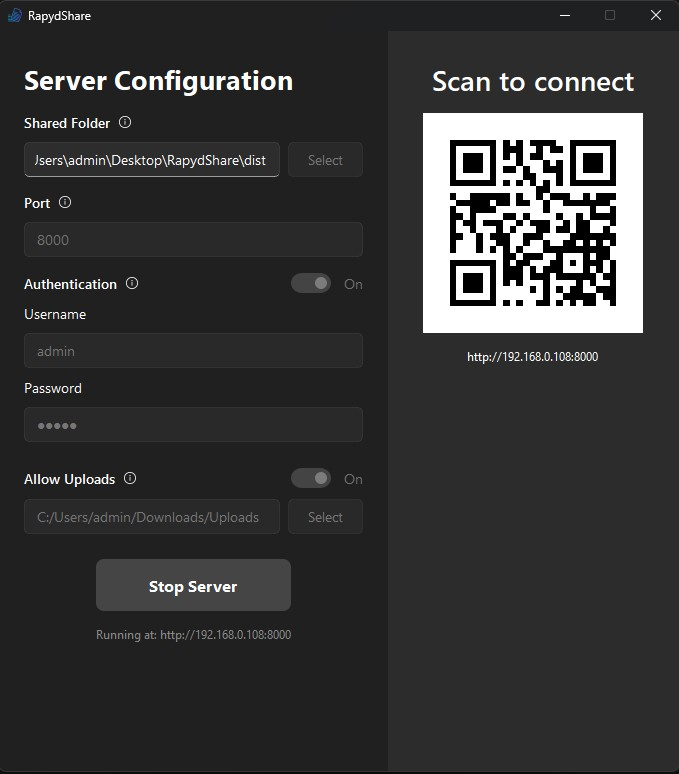
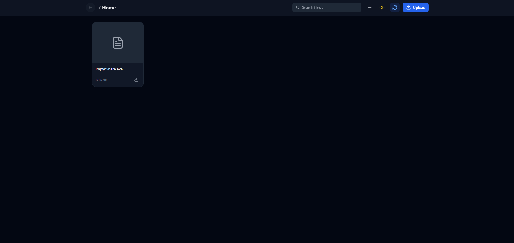

# RapydShare ⚡

A modern, fast local file transfer tool.

\
*RapydShare.exe*

\
*RapydShare Web Client*

## 🚀 Features

- **Fast Transfer:** Utilizes the full bandwidth of your local network.
- **Two-Way Sharing:** Download files from the host *and* upload files back to it — with drag-and-drop, multi-file progress, and an opt-in host toggle.
- **Modern UI:** Clean, responsive Windows 11 style interface (PyQt6 + Fluent Widgets).
- **Web Client:** Responsive React + TypeScript web interface for mobile and desktop clients.
- **Rich Previews:** Built-in image, video, and PDF previews.
- **Access Code:** Shares are protected by an access code by default. It is shown in the app, carried in the QR code and link, and typed into the code boxes if you open the address by hand. You can turn it off with the **Require access code** switch, but then anyone on the network can open the share, and the app shows a warning.
- **Safe Defaults:** Hidden and system files are never shared, and uploads are off until you turn them on.
- **Windows & macOS:** Desktop app for both, powered by Python (FastAPI) and React.

## 🛠️ Tech Stack

- **Backend:** Python, FastAPI, Uvicorn
- **Frontend:** React, TypeScript, Tailwind CSS, Vite
- **Desktop GUI:** PyQt6, QFluentWidgets
- **Build Tool:** PyInstaller

## 📦 Installation & Usage (For Users)

### Windows

Download the latest `RapydShare.exe` from the [Releases Page](https://github.com/Overresurrect/RapydShare/releases) and run it.

### macOS

Requires a Mac with Apple Silicon (M1 or newer) running macOS 14 Sonoma or later.

1. Download the latest `RapydShare-mac-arm64.dmg` from the [Releases Page](https://github.com/Overresurrect/RapydShare/releases).
2. Open it and drag **RapydShare** into your **Applications** folder.
3. Open RapydShare. The app isn't signed with an Apple Developer certificate, so macOS blocks it the first time:
   1. Click **Done** on the warning.
   2. Open **System Settings → Privacy & Security**, scroll down, and click **Open Anyway** next to the RapydShare message.
   3. Confirm with **Open Anyway**. You only need to do this once.

   Comfortable with the terminal? `xattr -dr com.apple.quarantine /Applications/RapydShare.app` does the same thing.
4. If macOS asks whether RapydShare can accept incoming network connections or find devices on your local network, click **Allow** — other devices can't connect otherwise.

### Sharing Files

1. Select a folder to share and click **Start Server**.
2. (Optional) Flip on **Allow Uploads** and pick an upload folder if you want clients to be able to send files to you.
3. Open the URL shown in the tool on your client device (iPhone, Android, laptop, etc.), including the port number — or scan the QR code, which carries the access code. If you type the address instead, enter the access code shown in the app into the code boxes.

> **Connections are not encrypted.** The access code keeps other people on the network from browsing your files, but anyone who can watch the traffic can read it. Only share on networks you trust.

## 💻 Development Setup (For Contributors)

### Prerequisites

- Python 3.12+ (release builds from `requirements.lock` use Python 3.12, which is what the lock is resolved for)
- Node.js & npm

> **macOS:** use a Python from [python.org](https://www.python.org/downloads/macos/) or `uv python install`, not Homebrew's or pyenv's. Those are built for your exact macOS version, so an app built with them won't open on older Macs. `build.py` warns you if this happens.

### 1. Clone the Repository

```bash
git clone https://github.com/Overresurrect/RapydShare.git
cd RapydShare
```

### 2. Backend Setup

```bash
pip install -r requirements.txt
```

For release builds, install the hash-locked set instead, so you get exactly the vetted packages:

```bash
pip install --require-hashes -r requirements.lock
```

### 3. Frontend Setup

```bash
cd frontend
npm install
```

### 4. Running the App

The desktop app serves the built React frontend, so build it once before running:

```bash
cd frontend
npm run build
cd ..
python main.py
```

For active frontend development, you can run the Vite dev server in parallel:

```bash
cd frontend
npm run dev
```

### 5. Building the App

Install the locked dependencies first (see Backend Setup), then:

```bash
# Build the React frontend first
cd frontend
npm run build
cd ..

# Then run the PyInstaller build script
python build.py
```

Run the build on the platform you're building for. The results land in the `dist/` folder:

- **Windows:** `RapydShare.exe`
- **macOS:** `RapydShare.app`, plus `RapydShare-mac-arm64.dmg` ready to upload to a release. The script also prints the minimum macOS version the app supports.

The macOS icon (`assets/RapydShare.icns`) is generated from the Windows icon by `python make_mac_icon.py`. Pass a larger transparent PNG (e.g. `python make_mac_icon.py artwork.png`) for a sharper icon.

## 📄 License

See [LICENSE](LICENSE) for details.
